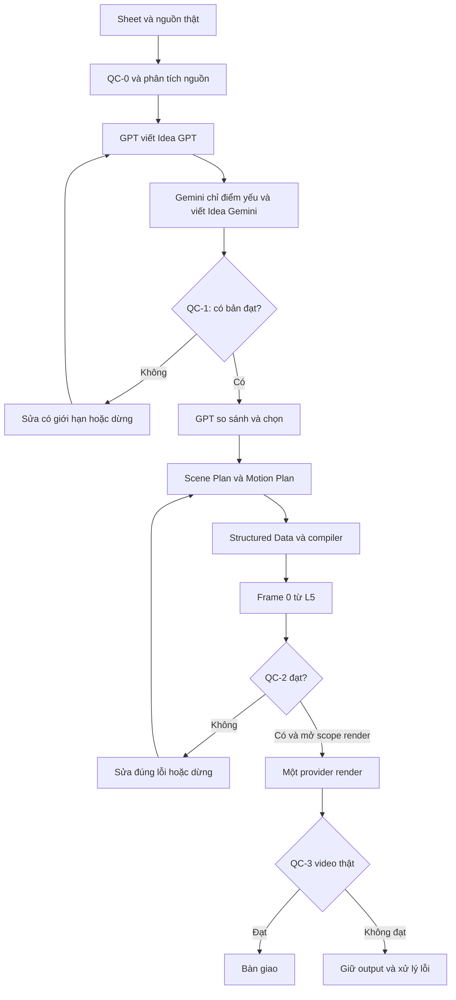

# THE LITTLE DAYS — WORKFLOW V2
Ngày thiết kế: 29/10/2026 — Asia/Bangkok  
Trạng thái: BẢN THIẾT KẾ MỚI, chưa triển khai hay kích hoạt  
Phạm vi hiện tại: kiểm chứng một IDEA_TEST đến hết lựa chọn idea; chưa render.

## 1. Mục tiêu và ranh giới
Thiết kế độc lập với runner cũ. Tái sử dụng tài nguyên có giá trị (video nguồn, ảnh L5, máy Mia, GitHub, Sheet), không kế thừa giả định rằng kết nối cũ đã hoạt động.

Chuỗi biên tập bắt buộc:
**Idea gốc → GPT viết idea mới → Gemini đánh giá bản GPT → Gemini viết lại → So sánh và chọn bản tốt hơn.**

C và D là hai tác phẩm độc lập, được lưu phiên bản; không ghi đè lẫn nhau. Bản thắng được tham chiếu bằng ID/hash, không thay nội dung C bằng D. Không mặc định Gemini tốt hơn. Cả hai không đạt → NEEDS_IDEA_REVISION, tuyệt đối không sang sản xuất.

Tối ưu bằng cách giảm dữ liệu và số lần gọi mô hình; không đổi tên quota thành miễn phí. Code chạy trên Mia/GitHub không cần mô hình cho thao tác kỹ thuật. Việc sáng tạo, đánh giá ngữ nghĩa và xem video vẫn cần năng lực AI và có giới hạn sử dụng.

## 2. Phân công
| Thành phần | Trách nhiệm chính | Không được làm |
|---|---|---|
| GPT | Điều phối logic; viết bản idea GPT; so sánh hai bản bằng rubric; lập Scene Plan, Motion Plan và dữ liệu cảnh khi idea đạt | Giả làm Gemini; tự chọn bản mình mà không có luận cứ; rút thoại để ép thời lượng |
| Gemini thực | Đọc Sheet trực tiếp khi khả dụng; chỉ ra điểm yếu GPT; viết bản Gemini; review ngữ nghĩa trước render và video thật | Tuyên bố đã xem video/ảnh chỉ vì đọc được URL; tự phê duyệt bản mình là bản thắng |
| GitHub repository | Lưu code, schema, compiler, chính sách QC, hồ sơ nhân vật; kiểm thử và lịch sử thay đổi | Lưu credential, video riêng tư hoặc phản hồi nhạy cảm vào repo |
| GitHub Actions | Điều phối tác vụ hữu hạn, kiểm tra cấu trúc, định tuyến job, cập nhật trạng thái và retry | Coi GitHub là mô hình AI hay trình duyệt đã đăng nhập |
| Mia | Runner cục bộ; tải media; ffprobe/ffmpeg; hash, cache, lưu file và state bền vững; UI adapter nếu được hỗ trợ và đã kiểm chứng | Dùng terminal đi vòng chặn bảo mật; dùng phiên Google cá nhân trên runner cloud |
| Sheets | Bảng điều khiển input, hai bản idea, kết quả chọn và trạng thái dễ đọc | Là kho video hay nguồn state duy nhất cho job đang chạy |
| Drive | Lưu nguồn, L5, hồ sơ đầu ra, phản hồi và bằng chứng theo phiên bản | Quyền chia sẻ công khai mặc định |
| Gemini in Sheets / Gemini Web | Giao diện review có thể dùng gói tài khoản hiện có | Giả định có endpoint cho GitHub điều khiển chỉ vì cùng hệ sinh thái |
| Flow/Veo hoặc Grok | Render cảnh theo capability đã kiểm chứng | Tự cắt thoại, đổi danh tính hoặc tự chạy cả hai provider |
| Người sở hữu | Cấp quyền khi thực sự thiếu; kiểm duyệt thiết kế và xem kết quả | Phải tải lại file hay đăng nhập lại khi phiên được hỗ trợ vẫn dùng được |

GitHub giữ mã nguồn và lịch sử quyết định; Mia thực thi phần cần ổ đĩa/media hoặc phiên UI. State runtime lưu trong SQLite trên Mia và backup có phiên bản lên Drive. Nếu runner khác cần truy cập cùng state phải có kho giao dịch chung; không mở SQLite qua ổ mạng.

ChatGPT Work chỉ nhận bản tóm tắt trạng thái, lỗi và quyết định cần suy luận. Không trở thành vòng lặp poll từng giây. Những lần gọi GPT tự động qua API là tùy chọn riêng; nếu chưa cấu hình hợp lệ, bước GPT chờ tương tác Work, không giả lập chế độ unattended.

## 3. Hai đường tích hợp Gemini
### Đường ưu tiên: Google-native
1. GPT ghi bản mới vào Idea GPT.
2. UI adapter được hỗ trợ mở đúng Sheet, dùng Gemini side panel để đọc bản hiện hành.
3. Yêu cầu Gemini nhắc lại idea ID và một chi tiết đặc trưng trong C để kiểm chứng đúng dữ liệu.
4. Gemini trả critique và rewrite trong cùng một lượt; lưu phản hồi gốc và bằng chứng phiên.
5. Bộ đồng bộ kiểm tra lại input/hash và chỉ ghi bản Gemini vào D cùng liên kết review.
6. GPT nhận cả hai bản và review dưới dạng dữ liệu ngắn để quyết định.

Ưu tiên để Gemini trả kết quả cho adapter ghi đúng vùng ô, thay vì yêu cầu side panel tự sửa nhiều cột. Nếu side panel thực sự hỗ trợ điền vùng, chỉ cho phép D của idea hiện hành và kiểm tra diff sau ghi.

**Điều kiện hoạt động:** tài khoản có tính năng, quyền truy cập đúng file và UI adapter được môi trường cho phép. GitHub Actions không tự gọi được side panel bằng Sheets API. Nếu không có adapter phù hợp → WAITING_GEMINI_CONNECTION. Có thể dùng thủ công để kiểm chứng năng lực, nhưng không gọi đó là automation hoàn chỉnh.

### Media là đường kiểm chứng riêng
Đọc văn bản Sheet không đồng nghĩa đã xem video B hoặc ảnh L5. Thử media thực tế và yêu cầu quan sát có thể đối chiếu. Nếu đường native không đọc được media, Mia đính kèm file thực qua giao diện được hỗ trợ. Không bắt người dùng tải file thủ công nếu adapter làm được.

Nếu chỉ review được văn bản: lưu scope TEXT_ONLY và media_verified=false; được phép nhận xét cấu trúc câu chuyện, không được công nhận source/identity QC đã đạt.

### Đường API tùy chọn
Khi đã được cấu hình và có ngân sách: GitHub/Mia gọi GPT hoặc Gemini API để có tác vụ máy đọc được, log token và response ID. Không tự chuyển từ Web sang API có tính phí; không tạo key production. API quota khác giới hạn của ứng dụng Web. Nếu quota hết: lưu state và chờ, không chạy vòng retry hoặc đổi tài khoản để né hạn mức.

## 4. Luồng và đầu ra từng bước
| Bước | Chủ trì | Đầu ra bền vững | Điều kiện đi tiếp |
|---|---|---|---|
| 0. Intake / QC-0 | Code | input_manifest, hash video/L5, metadata, kiểm tra schema | Nguồn truy cập được, ID duy nhất, L5 hợp lệ |
| 1. Source analysis | Gemini xem media; code chuẩn bị | source_analysis với quan sát, âm thanh, thoại và độ chắc chắn | Video/audio thực được kiểm chứng; thiếu bằng chứng thì giữ pending |
| 2. GPT idea | GPT | idea_gpt.vN và hash | Có setup, nguyên nhân, payoff; đúng bốn hồ sơ khi xuất hiện |
| 3. Critique + rewrite | Gemini | review_gpt.vN, idea_gemini.vN, response evidence | Có điểm yếu cụ thể, không review nhầm phiên bản |
| 4. Compare / QC-1 | GPT + code | selection.json, rubric hai bản, lý do | Ít nhất một bản đạt toàn bộ hard gate và ngưỡng |
| 5. Scene Plan | GPT | scene_plan.json | Đủ diễn biến, chủ thể, thoại, cảnh và thời gian |
| 6. Motion Plan | GPT | motion_plan.json | Đủ spatial anchors, nhân quả và thời gian biểu cảm |
| 7. Compile | Code | scene_data.json, canonical_prompt.txt, provider_settings.json | Schema và quy tắc xác định PASS |
| 8. Frame 0 + QC-2 | Image provider + Gemini visual review + code | frame, reference evidence, qc2 report | Frame thật đạt; mọi kiểm tra trước render đạt |
| 9. Render | Một provider được chọn | submission receipt, job ID, video thật | Đã được mở scope render; không có job trùng |
| 10. QC-3 | Gemini xem video + code | actual_video_review và quyết định | Đúng thoại, nhân vật, diễn xuất và tính liên tục |
| 11. Deliver | Code | link video, manifest, phiên bản và hạn chế | QC-3 đạt; không tự đăng mạng xã hội |

Source analysis trước GPT là công việc chuẩn bị bằng chứng, không thay đổi thứ tự tác giả đã thống nhất. Một lượt Gemini đọc media có thể tạo source_analysis để GPT dùng; lượt Gemini kế tiếp bắt buộc diễn ra sau khi GPT đã viết C, nhằm critique và rewrite độc lập.

## 5. QC-1 và cách chọn công bằng
Mỗi tiêu chí 0–5, tổng 100 theo trọng số đề xuất:
- Dễ hiểu setup: 20.
- Nhân quả và logic không gian: 20.
- Payoff, cảm xúc và thời điểm twist: 20.
- Hợp gia đình The Little Days, hành vi bé và chó: 15.
- Khả thi với engine, số hành động/đạo cụ: 15.
- Tính tự nhiên với khán giả Mỹ, lời thoại gọn khi cần: 10.

Ngưỡng khởi điểm: >=80/100 và không tiêu chí nào dưới 3/5; hiệu chỉnh sau pilot, không coi điểm số là xác suất thành công.
Hard fail: không đủ bằng chứng nguồn cho nhận định bắt buộc; đổi nhân vật; thiếu nguyên nhân; hành vi không khả thi; nội dung không phù hợp; dựa vào thoại bị cắt; twist không thể thể hiện rõ.

Gemini phải trả danh sách: vị trí/beat yếu → lý do → ảnh hưởng người xem → sửa đề xuất. Nếu không thấy lỗi vật chất, ghi rõ lý do và rủi ro còn lại; không bịa lỗi để đủ số lượng.

GPT chấm hai bản theo cùng rubric, trích beat làm bằng chứng. Lưu tác giả thật nhưng có thể dùng nhãn A/B trong phiếu chấm để giảm thiên vị; việc này không đảm bảo đánh giá hoàn toàn độc lập.
- Một bản đạt: chọn bản đó.
- Hai bản đạt: chọn điểm cao hơn; bằng điểm ưu tiên ít rủi ro thực hiện hơn, sau đó ít phức tạp hơn.
- Hai bản không đạt: không có winner, không sinh script/frame.
- Chỉ làm một vòng sửa idea có mục tiêu, nếu vẫn không đạt → NEEDS_REWORK.
- Bất đồng nghiêm trọng hoặc không đủ bằng chứng: NEEDS_REVIEW, không tự gán PASS.
Không ghép lén hai bản thành “bản thắng”. Bản tổng hợp nếu cần là candidate mới và phải qua QC-1 lại.

## 6. Character Identity Lock
L5 là nguồn nhận diện duy nhất, lấy bytes thật và lưu Drive file ID, hash, phiên bản. Không suy luận giọng nói/tính cách từ ảnh. Các thuộc tính chưa có bằng chứng được ghi PROPOSED, chưa được gọi là canon đã xác minh.

| ID | Nhận diện theo L5 cần khóa | Tính cách/hành vi đề xuất | Voice profile đề xuất |
|---|---|---|---|
| FATHER | Mặt, tóc, vóc dáng đúng L5; mặc định sage + jeans | Ấm áp, hơi chậm nhận ra trò của bé; phản ứng bằng ánh mắt trước hành động | Nam trưởng thành, US English tự nhiên, ấm, không cường điệu |
| MOTHER | Mặt, tóc, vóc dáng đúng L5; terracotta + cream | Tinh tế, quan sát tốt; nụ cười và cử chỉ nhẹ | Nữ trưởng thành, US English tự nhiên, ấm và rõ |
| DAUGHTER | Bé khoảng hai tuổi, hai búi/two pigtails, váy peach theo L5 | Quả quyết ngây thơ; chỉ tay/ánh mắt/cái gật nhỏ; động tác đúng tuổi | Toddler US English, câu ngắn khi cần, không thoại kiểu người lớn |
| DOG | Dachshund nâu, tỷ lệ và vòng cổ teal đúng L5 | Tò mò, chờ đợi; nhìn chủ, vẫy đuôi đúng ngữ cảnh | Chó không nói tiếng người; bark/whine chỉ khi có trong kế hoạch |

Lưu character_bible.v1 với observed_visual, proposed_personality, proposed_voice và lock_status riêng. Voice profile mô tả không đảm bảo engine giữ cùng giọng. Nếu engine hỗ trợ voice ID/voice reference hợp lệ, lưu asset/ID và kiểm chứng qua video thật; nếu chưa có → voice_consistency=UNVERIFIED.

Trang phục là episode_wardrobe_lock: chốt trước Frame 0 và giữ toàn video. Mặc định dùng L5; chỉ đổi bằng thay đổi có chủ đích đã ghi trong phiên bản, không lấy quần áo từ video nguồn. Tất cả bốn nhân vật có hồ sơ; không bắt buộc nhồi cả bốn vào mọi shot.

## 7. Voice & Dialogue Ownership
Mỗi câu có line_id, speaker_id, exact_text (US English), shot_id, start/end hoặc time window, emotion, delivery, listener_actions và audio_notes.
- Speaker phải là một ID hợp lệ.
- exact_text bất biến từ script đến compiler/render/QC.
- Phát hiện trùng ID, thiếu speaker, câu bị mất, đổi thứ tự và chồng lời không chủ ý.
- Nhân vật còn lại có trạng thái rõ: nhìn ai, làm gì, im lặng hay phản ứng.
- Đo thời gian nói thử/ước lượng cộng khoảng nghỉ và hành động; dự toán không phải bảo đảm lip-sync.
- Không đủ thời gian → tăng thời lượng trong capability hoặc chia shot, không cắt thoại hay đổi người nói.
- Nếu không có lời thoại, lưu dialogue=[] rõ ràng, không để engine tự thêm.
- Chó không sở hữu thoại người. Subtitle làm sau khi có audio thật nếu cần.

## 8. Spatial Anchor Logic và Motion Planning
Mỗi action_id phải có:
actor_id, initial_position, cause_event_id, movement, prop_transition, other_reactions, final_position, final_state, start/end, dependencies.

Spatial map dùng left/center/right theo khung hình và chiều sâu foreground/midground/background; phân biệt tay trái/phải của nhân vật với bên trái/phải màn hình. Mỗi đạo cụ có prop_id, owner/location và state.
Quy tắc code kiểm tra:
- Một đạo cụ không đồng thời có hai chủ nếu không có sự kiện chuyển giao.
- Chuyển giao phải có giver, receiver, thời điểm và trạng thái trước/sau.
- Không dịch chuyển tức thời nếu không có chuyển cảnh hợp lý.
- Reaction xảy ra sau cause; punchline sau setup.
- Shot sau khởi tạo từ end_state shot trước; đổi góc máy phải ánh xạ lại screen position.
- Không cho quan hệ nhân quả dạng vòng.
- Cử chỉ của bé đúng khả năng vận động và tầm với.

Mặc định một hành động chính và một phản ứng đơn giản trong mỗi shot; chỉ tăng khi diễn tập thời gian cho thấy rõ. Không đặt giới hạn cứng cho mọi câu chuyện. Giữ khoảng dừng biểu cảm và nhịp nhận ra; không thêm bước đi/camera xoay để kéo thời lượng.

Camera chọn theo nhu cầu: medium giới thiệu tình huống, close-up cho tín hiệu nhỏ, wide khi cần thấy quan hệ hành động, reaction shot cho payoff. Chỉ thêm camera motion có lý do. Đây là vận dụng các ví dụ người dùng cung cấp, không tuyên bố đã kiểm chứng toàn bộ phương pháp FastAIVN.

## 9. Structured Prompt Compiler
Pipeline: selected idea → Scene Plan → Motion Plan → Structured Scene Data → canonical video prompt.

Dữ liệu tối thiểu:
```json
{
  "schema_version": "tld.scene.v2",
  "idea_id": "IDEA_TEST",
  "selected_candidate_hash": "actual-hash",
  "character_bible_version": "v1",
  "reference": {"cell": "L5", "drive_file_id": "actual-id", "sha256": "actual-hash"},
  "wardrobe_lock": {},
  "shots": [{
    "shot_id": "S01",
    "duration_s": 0,
    "opening_state": {},
    "camera": {"framing": "medium", "motion": "static", "story_reason": ""},
    "actions": [],
    "dialogue": [],
    "ending_state": {}
  }],
  "forbidden_changes": ["extra characters", "speaker swaps", "extra dialogue"],
  "provider_profile_version": "verified-profile"
}
```
Đây là minh họa schema, duration_s=0 và placeholder không hợp lệ để render. Validator yêu cầu thời lượng dương, dữ liệu thực và đầy đủ.

Compiler là template code xác định, không gọi AI để ghép prompt dài. Đầu ra US English; dữ liệu tiếng Việt phải được chuyển thành trường US English trong bước lập kế hoạch, không để compiler tự đoán/biên dịch bằng AI ngầm.
Giữ một canonical prompt ngữ nghĩa, không tạo các bản thoại khác nhau cho Flow/Grok. Adapter chỉ ánh xạ setting và định dạng được engine chấp nhận. Incompatibility thay đổi nội dung phải tạo revision và QC-2 lại.
Capability profile có provider/model, thời điểm kiểm chứng, duration, aspect ratio, audio/lip-sync, image input, first/last frame support. UNKNOWN → không submit.

## 10. Frame 0, continuity và QC-2
Frame 0 là trạng thái trước hành động đầu tiên, không thể hiện payoff hoặc kết quả hành động. Tạo từ bytes L5 thật. Các shot sau dùng start_state tương ứng; không phải shot nào cũng lấy lại frame mở đầu video.

QC-2 có hai phần:
- Code: schema, hash/input version, danh sách diễn viên, thoại bất biến, thời gian và phụ thuộc, prop ownership, capability, output thật tồn tại, mọi report bắt buộc.
- Gemini visual/semantic: so Frame 0 với L5 và Scene Plan; mặt, tuổi, outfit, tay/chân, giày, đạo cụ, bố cục, mở đầu chưa diễn và chưa lộ twist; logic/khả thi của motion.

Không dùng kiểm tra có file để thay thế việc xem hình. Báo cáo cần reviewer/provider thật, input hashes, findings, verdict và evidence.
Trước render, planned end_state phải nối đúng planned start_state tiếp theo; **chỉ sau render mới kiểm chứng được frame cuối thực tế**.
Chỉ tạo thêm keyframe nếu continuity thật sự cần và engine đã xác nhận hỗ trợ. Không giả định mọi engine nhận first+last frame.
Tối đa hai sửa Frame 0 có mục tiêu, sau đó dừng nếu vẫn lỗi. Không render thử để né QC-2 chưa đạt.

## 11. Bốn tầng QC
| Tầng | Tín hiệu kiểm tra | Khi fail |
|---|---|---|
| QC-0 | Schema Sheet, source access/hash, L5 bytes, input trùng, media/audio evidence | NEEDS_INPUT; không gọi tác giả khi thiếu nguồn bắt buộc |
| QC-1 | Hai candidate, critique thật, chất lượng và selection evidence | NEEDS_IDEA_REVISION hoặc NEEDS_REVIEW |
| QC-2 | Scene/Motion/Dialogue, character/wardrobe, frame thực, continuity dự kiến, provider capability | NEEDS_PRE_RENDER_FIX; tuyệt đối chưa render |
| QC-3 | Video/audio thực: người nói, nguyên văn, thứ tự, biểu cảm, hành động, props, frame đầu/cuối, artifact | NEEDS_VIDEO_FIX; lưu lỗi và đề xuất, không gắn nhãn final |

QC-2 được ưu tiên ngân sách review vì bắt lỗi sớm thường giảm render lại. Không tầng nào bảo đảm đầu ra engine không lỗi. QC-3 vẫn bắt buộc để bàn giao đạt chất lượng; confidence thấp hoặc không xem được audio/video phải là INCONCLUSIVE.

## 12. State, version và retry
Task key = idea_id + stage + hash(input dependencies) + schema/model/prompt version có ảnh hưởng. Mỗi stage lưu trạng thái, timestamps, attempt, input hashes, output hashes/URLs, provider, real response/job ID nếu có, lỗi và next_action.

Trạng thái kỹ thuật:
NEW → VALIDATING → READY → RUNNING → SUCCEEDED.
Nhánh khác: WAITING_CONNECTION, WAITING_QUOTA, NEEDS_INPUT, NEEDS_REWORK, RETRYABLE_ERROR, FAILED, SUBMISSION_UNKNOWN.
“SUCCEEDED” của bước đóng gói không đồng nghĩa QC creative PASS.

Lease/lock theo task; ghi output bền vững trước state SUCCEEDED. Sheet là projection cập nhật từ outbox; nếu ghi Sheet lỗi thì retry sync, không gọi AI lại. Runtime journal lưu sự kiện và previous/new state.

Reread trước khi ghi: idea ID, source revision, C hash và L5 hash phải còn đúng. Input đổi → phiên bản mới; giữ lịch sử, chỉ vô hiệu hóa các stage phụ thuộc. Không sửa A/B/L5 hoặc checkbox admin.
Không dùng row number làm danh tính duy nhất. Không execute lệnh lấy từ nội dung ô.

Retry đề xuất:
- Lỗi mạng/read-only transient: tối đa 2 retry, backoff + jitter.
- 429 quota hết: tôn trọng Retry-After khi có; WAITING_QUOTA, không đổi model/tài khoản âm thầm.
- Auth/CAPTCHA/quyền: WAITING_CONNECTION, không retry vòng.
- Sai JSON: một lần yêu cầu sửa định dạng trên cùng nội dung; không coi đó là review mới.
- Timeout sau submit AI/render: SUBMISSION_UNKNOWN; đối soát lịch sử/job trước khi thử lại.
- Sửa chất lượng idea: 1 vòng; Frame 0: 2 vòng; render lại mặc định 0 khi chưa được mở scope/ngân sách.
Không hứa exactly-once với provider UI không có idempotency. Trạng thái không rõ phải dừng để đối soát, không bấm submit lần nữa.

## 13. Tối ưu quota
1. ffprobe, ffmpeg, download, hash, validation, compiler, state và sync bằng code.
2. Phân tích nguồn một lần theo content hash; chỉ gửi lại media khi nội dung đổi hoặc review cần xem trực tiếp.
3. GPT tạo một candidate, không tự phát sinh 5–10 biến thể.
4. Gemini gộp critique + rewrite trong một phản hồi có cấu trúc.
5. GPT chọn và lập Scene/Motion Data trong một tác vụ khi cả dữ liệu và budget cho phép; vẫn lưu từng stage và gate riêng.
6. Gemini QC-2 review gói hoàn chỉnh một lượt, sau khi code đã bắt lỗi cấu trúc. Khi frame có sau thì review phải bao gồm frame thật, không đánh dấu trước.
7. Cache theo hash + model/prompt/schema; không cache chỉ theo URL.
8. Sửa phần lỗi và tái kiểm tra phần phụ thuộc; không chạy lại mọi thứ.
9. Chỉ đưa báo cáo ngắn vào Work; giữ media và log lớn trên Mia/Drive.
10. Không thêm AI “review của reviewer” vô hạn. GPT lựa chọn là gate cuối QC-1; trường hợp tranh chấp chuyển NEEDS_REVIEW.

Lượt AI mục tiêu cho idea thông thường: 1 lần phân tích nguồn bởi Gemini + 1 GPT draft + 1 Gemini critique/rewrite + 1 GPT so sánh = 4 tác vụ. Có thể giảm còn 3 khi phân tích nguồn đã có và vẫn hợp lệ. Đây là mục tiêu tác vụ, không bảo đảm số API request hoặc mức tính quota; một phiên UI có thể bị gián đoạn hoặc cần đính kèm riêng.
Đo ai_calls, API input/output tokens khi có, media bytes, retries, cache_hits, review latency và số render lại. Không suy ra quota Work đã tiết kiệm bao nhiêu từ số tests hoặc số dòng code.

## 14. Sheet và kho kết quả mới
Không bắt buộc tạo thêm spreadsheet. Dùng Sheet mới hiện có làm UI nhưng schema workflow V2 độc lập; chưa sửa trực tiếp trong bản thiết kế này.

Production giữ A=idea ID, B=source, C=Idea GPT, D=Idea Gemini, L5=canonical reference. Mở rộng theo tên trường khi triển khai:
- selected_candidate (GPT/GEMINI/NONE), selected_version, selection_reason, QC1_status.
- review_link chứa critique và phiếu chấm, không nhồi mọi log vào ô.
- current_stage, state, revision, next_action và output manifest link.
- Scene/Motion/Frame/Prompt/Video links theo giai đoạn.
Mọi thêm/sửa cột phải đọc metadata/header sống và migration có version; không xê dịch L5 hoặc ghi đè admin.
Các bảng logic phụ: CHARACTER_BIBLE, CONFIG, RUN_LOG. Hồ sơ đầy đủ và artifact JSON ở Drive/Mia, code/schema ở GitHub. Không tạo một cột riêng cho mỗi retry.

Repo mới dưới workflow_v2/:
schemas/, compiler/, validators/, adapters/sheets/, adapters/gemini_native/, adapters/ai_api/, adapters/render/, state/, tests/, docs/.
Không import orchestration cũ làm nền. Có thể tái sử dụng helper media đã kiểm chứng sau khi review.
Mia runtime: .runtime/workflow_v2/{idea_id}/{revision}/{stage}/.
Google OAuth dùng quyền tối thiểu đã có; không commit credentials. Chi tiết bí mật không đi vào prompt, log hay workflow YAML.

## 15. Sơ đồ

Mọi cạnh sửa đều chịu retry budget; không phải vòng lặp vô hạn. Provider/API/UI unavailable thì stage chuyển WAITING_CONNECTION, không bỏ gate.

## 16. Kiểm chứng trước khi triển khai rộng
Pilot 1 — chỉ IDEA_TEST:
- Gemini đọc trực tiếp đúng C5 từ Sheet và trả lại thông tin kiểm chứng.
- Kiểm chứng riêng quyền xem video nguồn và L5; không gán media PASS từ text.
- Lưu critique thật + rewrite vào D5; C5 không đổi.
- GPT chấm cùng rubric và chọn GPT/GEMINI/NONE với bằng chứng.
- Thử chạy lại không tạo response mới khi input không đổi; sửa C sẽ tạo revision.
- Kiểm tra cả hai fail thì không sinh script.
Dừng ở đây. Chỉ sau pilot thành công mới triển khai Scene/Motion/Compiler và QC-2; render vẫn tắt theo phạm vi hiện tại.

Acceptance automation đầy đủ chỉ đạt khi có một lần chạy thật qua các kết nối, giữ đúng dữ liệu, lưu response/job evidence, đối soát được sau lỗi và không cần thao tác giả định. Unit tests PASS chỉ xác nhận logic đã test.

## 17. Nguồn tham khảo về tích hợp
- Gemini in Sheets: https://support.google.com/docs/answer/14356410 — đọc/phân tích và thao tác trong Sheets; yêu cầu gói đủ điều kiện.
- Gemini Connected Apps (Workspace): https://support.google.com/gemini/answer/14959807 — khả năng phụ thuộc tài khoản; tài liệu liệt kê giới hạn truy cập ảnh/video Drive qua Connected Apps. Cần phân biệt với đính kèm file trực tiếp.
Đây là thiết kế sử dụng các năng lực được tài liệu mô tả, không phải xác nhận tài khoản hiện tại đã bật mọi tính năng.
